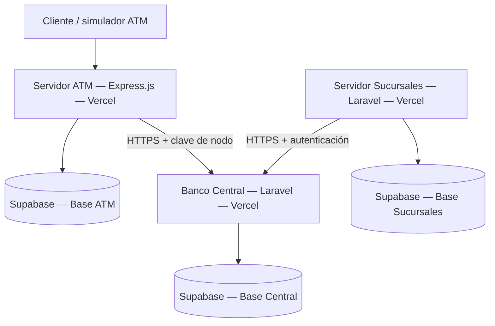

# Servidor ATM — Sistema Bancario Distribuido

> **Estado:** documentación inicial. El código del servidor y sus rutas aún están en desarrollo; las funcionalidades descritas son objetivos del proyecto, no implementaciones verificadas.

## Descripción

Nodo **ATM (cajero automático)** del Sistema Bancario Distribuido. Su objetivo es ofrecer una API para gestionar operaciones de cajero, consultar su estado operativo y comunicarse de forma segura con el **Banco Central**, que mantiene los saldos y transacciones oficiales.

Este repositorio corresponde al servidor ATM y se desarrolla por separado de los repositorios de Banco Central y Sucursales.

## Arquitectura



**Regla de integración:** el ATM no modifica directamente los saldos de cuentas en la base del Banco Central. Las operaciones que afectan dinero se solicitan a su API autorizada.

## Tecnologías previstas

- **Node.js y Express.js:** API del cajero.
- **Supabase (PostgreSQL):** persistencia de datos operativos del ATM.
- **Vercel:** plataforma acordada por el equipo para el despliegue.
- **GitHub:** repositorio y despliegue continuo.

## Base de datos ATM

El proyecto Supabase `servidor-atm` contiene estas seis tablas:

| Tabla | Propósito general |
|---|---|
| `atm_configuration` | Configuración del cajero. |
| `atm_cash_inventory` | Inventario de efectivo. |
| `atm_operations` | Registro local de operaciones. |
| `atm_cash_movements` | Movimientos de efectivo del cajero. |
| `atm_sync_queue` | Operaciones o eventos pendientes de sincronización. |
| `atm_event_logs` | Eventos y registros operativos. |

> Los campos y restricciones definitivos se consultan en el esquema SQL del proyecto. La base ATM no sustituye el libro de transacciones oficial del Banco Central.

## Funcionalidades previstas

- Consultar el estado y la configuración del ATM.
- Registrar operaciones y movimientos de efectivo según las reglas del examen.
- Solicitar al Banco Central la autorización de operaciones bancarias.
- Registrar eventos y errores para facilitar las pruebas.
- Gestionar sincronización o reintentos según la implementación del equipo.

## Variables de entorno

Crear un archivo `.env` local con los valores reales. **No subirlo a GitHub.** Los nombres deben validarse con el código definitivo.

```dotenv
# Servidor ATM — Supabase
SUPABASE_URL=https://TU_PROYECTO.supabase.co
SUPABASE_PUBLISHABLE_KEY=TU_CLAVE_PUBLICABLE
SUPABASE_SECRET_KEY=TU_CLAVE_SECRETA_SOLO_BACKEND

# API del Banco Central (NO es la URL de Supabase)
CENTRAL_API_URL=https://URL_PUBLICA_DEL_BACKEND_CENTRAL
CENTRAL_NODE_API_KEY=CLAVE_DE_NODO_EMITIDA_POR_BANCO_CENTRAL

# Entorno local
PORT=3000
```

**Seguridad:** la `SUPABASE_SECRET_KEY` y `CENTRAL_NODE_API_KEY` son secretos del servidor; nunca deben exponerse en el navegador, publicarse en el README o incluirse en commits. La clave de nodo es distinta de la clave secreta de Supabase. La URL del Banco Central se completará después de su despliegue.

## Instalación local (pendiente de validar)

Cuando el compañero responsable suba el proyecto Express y su `package.json`:

```bash
git clone https://github.com/Robel42-web/Servidor_atm.git
cd Servidor_atm
npm install
```

Configurar `.env` y ejecutar el script que finalmente se defina en `package.json` (por ejemplo, `npm run dev` o `npm start`). **Aún no se confirma el comando de arranque.**

## Despliegue previsto en Vercel

1. Importar el repositorio `Robel42-web/Servidor_atm` en el espacio de trabajo del equipo.
2. Verificar el directorio raíz y el punto de entrada de Express cuando exista el código.
3. Adaptar las rutas HTTP al entorno de funciones de Vercel, si corresponde.
4. Configurar las variables de entorno en **Project Settings → Environment Variables**.
5. Desplegar y probar los endpoints públicos.
6. Verificar la integración con la API del Banco Central.

> **Importante:** Vercel utiliza funciones sin servidor. No debe asumirse que un proceso Express permanece ejecutándose de forma continua. La persistencia debe mantenerse en Supabase; las tareas de sincronización prolongadas requerirán un diseño compatible con Vercel.

**URL pública del ATM:** pendiente de despliegue.

## API y OpenAPI

Los endpoints, métodos, cuerpos de solicitud, códigos HTTP y ejemplos se documentarán cuando el equipo termine de implementar las rutas.

- **Especificación OpenAPI/Swagger:** pendiente.
- **Ruta de documentación:** pendiente.
- **Pruebas de integración con Banco Central:** pendientes.

No se incluyen rutas inventadas para evitar diferencias entre el README y la implementación real.

## Pruebas previstas

- Conexión del servidor ATM con su base de datos Supabase.
- Autenticación entre ATM y Banco Central.
- Registro correcto de operaciones y movimientos de efectivo.
- Manejo de solicitudes inválidas, errores y reintentos.
- Comprobación de que el saldo oficial se modifica únicamente por los mecanismos autorizados del Banco Central.
- Despliegue automático a partir de GitHub una vez habilitado.

## Repositorios relacionados

- [Banco Central](https://github.com/Robel42-web/Banco_central)
- [Servidor Sucursales](https://github.com/Robel42-web/Servidor_sucursales)
- [Servidor ATM](https://github.com/Robel42-web/Servidor_atm)

## Estado del proyecto

- [x] Repositorio GitHub creado.
- [x] Proyecto Supabase del ATM creado.
- [x] Acceso de Vercel al repositorio autorizado.
- [ ] Código Express subido y revisado.
- [ ] Variables de entorno verificadas con el código.
- [ ] API y OpenAPI documentadas.
- [ ] Despliegue en Vercel realizado.
- [ ] Integración y pruebas completadas.

---

**Proyecto académico — Sistema Bancario Distribuido.** Este README se actualizará conforme avance el desarrollo del equipo.
